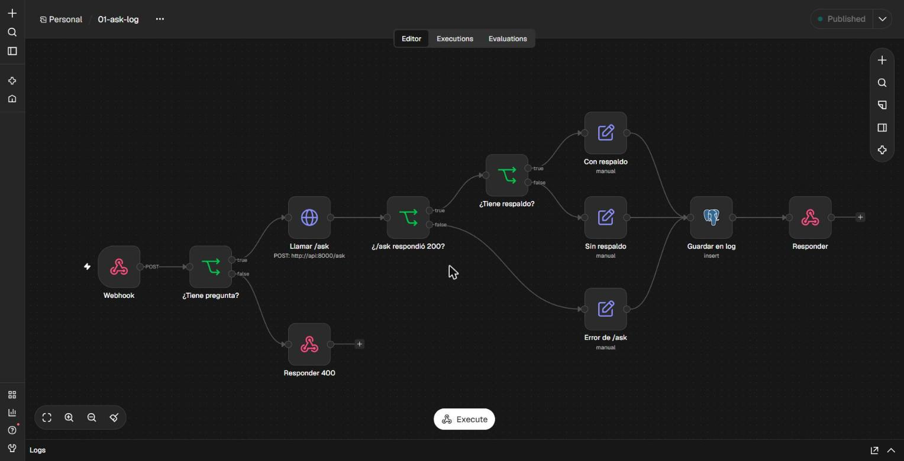
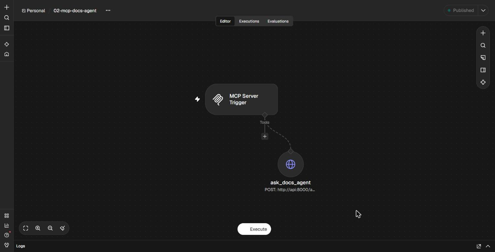
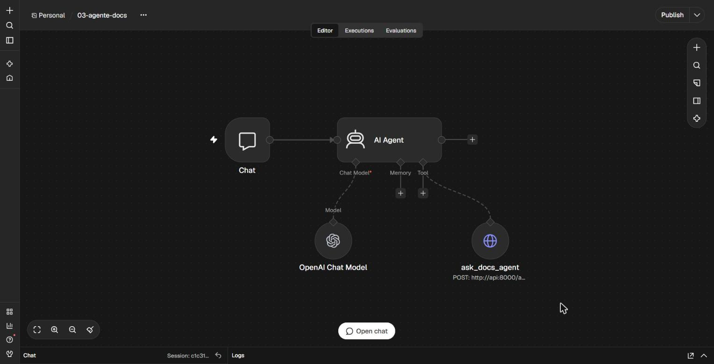

# docs-agent + n8n

docs-agent (el RAG con citas sobre la documentación de FastAPI) integrado con **n8n on-premise** de tres maneras:

| Workflow | Qué muestra |
|---|---|
| [`01-ask-log`](workflows/01-ask-log.json) | Webhook → API interna (`/ask`) → ramas por status y por `grounded` → log en Postgres (tokens incluidos) → respuesta |
| [`02-mcp-docs-agent`](workflows/02-mcp-docs-agent.json) | `/ask` expuesto como **servidor MCP** (con token Bearer) y usado desde **Claude Code** |
| [`03-agente-docs`](workflows/03-agente-docs.json) | **AI Agent** de n8n (gpt-4.1-mini) que decide cuándo llamar a docs-agent como herramienta |

Las decisiones y lo aprendido están en [NOTAS.md](NOTAS.md).

## Arquitectura

```
                 ┌────────────── red docker: docs-agent-langgraph-mcp_default ──────────────┐
 curl ──POST /webhook/ask──▶ n8n ──POST http://api:8000/ask──▶ api (FastAPI) ──▶ db (Postgres + pgvector)
 Claude Code ──MCP /mcp/docs-agent──▶ n8n ──────────┘                                   ▲
                                      n8n ──INSERT n8n_question_log──────────────────────┘
                                      n8n ──chat completions──▶ OpenAI (solo el agente 03)
                 └──────────────────────────────────────────────────────────────────────────┘
```

n8n corre en su propio compose y se une a la red del compose de docs-agent, así llama a `api` y `db` por nombre (N2 en las notas). Solo publica `127.0.0.1:5678`.

## Levantarlo

Requisitos: Docker, el compose de docs-agent levantado y el corpus ingerido (`curl -s http://127.0.0.1:8000/health` → `"chunks"` > 0).

```bash
# 1. docs-agent primero: su red es "external" para n8n
docker compose up -d                                   # desde la raíz del repo

# 2. tabla de log (idempotente)
docker compose exec -T db psql -U docs -d docs < integrations/n8n/sql/001_n8n_question_log.sql

# 3. n8n
cd integrations/n8n
cp .env.example .env                                   # y generar N8N_MCP_TOKEN: openssl rand -hex 32
docker compose up -d                                   # n8n 2.46.4 en http://127.0.0.1:5678
```

Abrir http://127.0.0.1:5678 y crear el usuario owner.

### Importar los workflows y crear las credenciales

Los JSON no traen secretos: cada nodo solo referencia su credencial por `{id, name}`. Hay que importarlos y crear las credenciales a mano:

```bash
for f in workflows/*.json; do
  docker compose cp "$f" n8n:/tmp/wf.json && docker compose exec -T n8n n8n import:workflow --input=/tmp/wf.json
done
```

| Credencial (tipo en n8n) | Usada por | Valores |
|---|---|---|
| Postgres | `01-ask-log` → *Guardar en log* | host `db`, puerto `5432`, base/usuario/clave `docs` (los de desarrollo del compose de docs-agent) |
| Bearer Auth | `02-mcp-docs-agent` → *MCP Server Trigger* | el `N8N_MCP_TOKEN` de `.env` |
| OpenAI | `03-agente-docs` → *OpenAI Chat Model* | key restringida a **List models: Read** + **Chat completions: Write**. Se carga con `import-openai-credential.ps1`, que la toma del portapapeles |

Luego, **Publish** en `01` y `02`. Las URLs de producción solo existen con el workflow publicado.

## Probarlo

### 01 · webhook → docs-agent → log



```bash
curl -s -X POST http://127.0.0.1:5678/webhook/ask \
  -H 'Content-Type: application/json' \
  -d '{"question":"¿Cómo se declara un request body?"}'
# → 200 {"answer": "...", "citations": [{"url": "https://fastapi.tiangolo.com/tutorial/body/", ...}], "grounded": true}
```

| Caso | Respuesta |
|---|---|
| pregunta cubierta por la doc | 200 con `answer`, `citations`, `grounded: true` |
| pregunta fuera de la doc | 200, `"No encontré esto en la documentación"`, `grounded: false` |
| body sin `question` / no JSON | 400 `{"error": ...}`, sin llamar a `/ask` |
| `/ask` falla (422, 429, 502, 503) | el mismo código, con `{"error": <detail de docs-agent>}` |
| docs-agent no responde (caído, timeout) | 502 `{"error": "docs-agent no respondió (caído o timeout)"}` |

Todo lo que llega a `/ask` queda en `n8n_question_log`, también los errores:

```sql
select http_status, grounded, count(*), sum(total_tokens)
from n8n_question_log group by 1, 2 order by 1, 2;
```

### 02 · MCP para Claude Code



```bash
claude mcp add --transport http --scope local n8n-docs-agent \
  http://127.0.0.1:5678/mcp/docs-agent --header "Authorization: Bearer $N8N_MCP_TOKEN"
claude mcp list        # n8n-docs-agent ... ✔ Connected
```

En una sesión nueva de Claude Code: *"pregúntale a docs-agent cómo se declara un request body"* → llama a `mcp__n8n-docs-agent__ask_docs_agent` y responde citando `https://fastapi.tiangolo.com/tutorial/body/`.

### 03 · Agente de IA en n8n



En el editor de n8n, **Open chat**:
- *"¿Cómo se declara un request body en FastAPI?"* → modelo → `ask_docs_agent` → modelo; responde con la cita (≈650 tokens en n8n).
- *"hola"* → responde sin llamar a la herramienta (≈220 tokens).

## Pruebas de humo

```bash
./smoke.sh          # todo: 1 (n8n) · 2 (tabla + webhook) · caida (apaga api un momento) · 3 (MCP)
./smoke.sh 2        # solo el paso 2
```

- `smoke.sh` comprueba que n8n responde solo en loopback y que llega a `api:8000`, el esquema de la tabla, y que cada llamada a `/ask` deja una fila.
- `smoke_webhook.py` cubre los casos de la tabla de arriba.
- `smoke_mcp.py` habla MCP "a mano" (`initialize` → `tools/list` → `tools/call`) y verifica que sin token responde 401/403.

Los casos que llegan a OpenAI gastan tokens, aunque pocos (~1k por pregunta).

> **No correr `pytest` de docs-agent con esto levantado:** los tests de integración vacían la base viva (también se borra el corpus).

## Antes de commitear un workflow

```bash
docker compose exec -T n8n n8n export:workflow --id=<id> --pretty --output=/tmp/wf.json
docker compose cp n8n:/tmp/wf.json workflows/<nombre>.json
python -I -X utf8 sanitize_export.py workflows/<nombre>.json   # quita dueño/correo y metadatos
```

El export nunca trae valores de credenciales, pero **sí** el nombre y el correo del dueño; `sanitize_export.py` los quita y falla si queda algún `@`.
